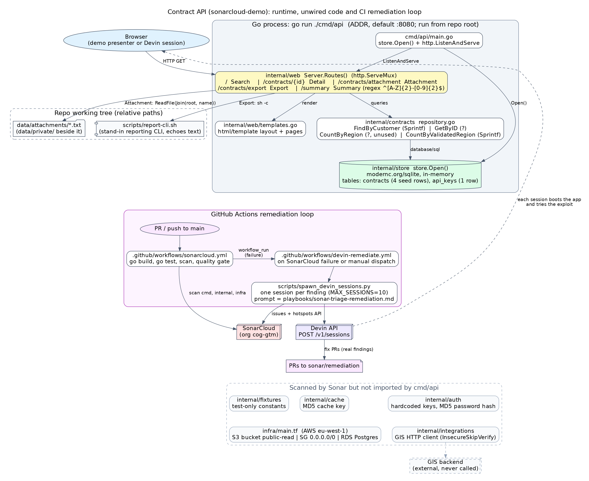

# Architecture: Contract API (Sonar remediation demo)

This repo is a demo, not a product: a small Go web app ("Contract Desk") with
planted SonarCloud findings, plus the CI workflows that turn a failed quality
gate into one Devin session per finding. The [README](../README.md) is the demo
talk track (in Spanish); this page describes how the code is put together.



The diagram source is [`diagrams/architecture.dot`](diagrams/architecture.dot)
(Graphviz). After editing it, run `docs/diagrams/render.sh` (needs
`graphviz`) to refresh [`architecture.png`](diagrams/architecture.png) and
[`architecture.svg`](diagrams/architecture.svg).

## Runtime: one Go process

| Piece | Code | What it does |
| --- | --- | --- |
| Entry point | `cmd/api/main.go` | Calls `store.Open()`, builds `web.Server{DB}` and serves `Server.Routes()` on `ADDR` (default `:8080`). No other configuration. |
| Store | `internal/store/store.go` | Opens an in-memory SQLite database (`modernc.org/sqlite`, pure Go, no cgo), `SetMaxOpenConns(1)`, creates `contracts` and `api_keys`, seeds 4 contracts (C-1001..C-1004) and 1 API key. Data is lost on restart. |
| Repository | `internal/contracts/repository.go` | `FindByCustomer` (LIKE query built with `fmt.Sprintf`), `GetByID` (parameterized), `CountByRegion` (parameterized, not called anywhere), `CountByValidatedRegion` (built with `fmt.Sprintf`, called only after the `/summary` regex check). |
| HTTP layer | `internal/web/handlers.go` | `http.ServeMux` with five handlers (below). |
| Templates | `internal/web/templates.go` | `html/template` layout plus search, detail and summary pages, all compiled at package init. |

### Routes

| Route | Handler | Reads from | Notes |
| --- | --- | --- | --- |
| `GET /?customer=` | `Search` | `contracts.FindByCustomer` | Echoes the query as `template.HTML` (the banner). Any other unmatched path returns 404. |
| `GET /contracts/{id}` | `Detail` | `contracts.GetByID` | 404 `contract not found` for unknown ids. |
| `GET /contracts/attachment?name=` | `Attachment` | `data/attachments/<name>` on disk | `filepath.Join` with no containment check. |
| `GET /contracts/export?id=` | `Export` | `sh -c "scripts/report-cli.sh --contract <id> --format pdf"` | Returns the script's plain-text output; no PDF is produced. |
| `GET /summary?region=` | `Summary` | `contracts.CountByValidatedRegion` | Rejects anything not matching `^[A-Z]{2}-[0-9]{2}$` with 400 before querying. |

`data/attachments` and `scripts/report-cli.sh` are relative paths, so the
binary must run with the repo root as its working directory (as
`go run ./cmd/api` from the root does). Started elsewhere, attachments return
404 and export returns 500.

## Code that is scanned but not wired in

These packages are in `sonar.sources` but nothing in `cmd/api` imports them.
They exist to give the scanner findings (real ones and the deliberate false
positives listed in the README):

- `internal/auth`: hardcoded signing key and service credentials, MD5 password hashing.
- `internal/cache`: MD5 used as a process-local cache key (false positive).
- `internal/fixtures`: test-only constants (false positive).
- `internal/integrations`: GIS HTTP client with `InsecureSkipVerify: true`; no caller, and no GIS backend is configured.
- `infra/main.tf`: AWS `eu-west-1` S3 bucket (`public-read`), security group open to `0.0.0.0/0`, unencrypted public RDS Postgres with a literal password. The Go app does not use any of it: it only runs on the in-memory SQLite store.

## CI and remediation loop

1. `.github/workflows/sonarcloud.yml` runs on pushes to `main` and on PRs:
   Go 1.22, `go build ./...`, `go test ./...`, the SonarCloud scan
   (`sonar-project.properties`: sources `cmd,internal,infra`, tests and
   `data/**` excluded), then the quality gate.
2. `.github/workflows/devin-remediate.yml` runs when the SonarCloud workflow
   completes with `failure` (or on manual dispatch with an optional PR
   number) and calls `scripts/spawn_devin_sessions.py`.
3. The script reads open issues (`VULNERABILITY,BUG`) and `TO_REVIEW`
   hotspots from the SonarCloud API, then calls `POST /v1/sessions` on the
   Devin API once per finding (capped by `MAX_SESSIONS`, default 10). Each
   prompt is `playbooks/sonar-triage-remediation.md` plus the finding.
4. Each session boots the app, tries the exploit in the browser, and either
   opens a fix PR against `sonar/remediation` (real finding) or reports a
   "Won't fix / Safe" justification (false positive).

Secrets needed: `SONAR_TOKEN` and `DEVIN_API_KEY` as repository secrets.

## Running and testing locally

```
go build ./...
go test ./...          # 2 tests in internal/contracts, against the seeded store
go run ./cmd/api       # http://localhost:8080 (set ADDR to change the port)
```

Go 1.18+ per `go.mod`; CI uses 1.22.
